# RJ45 to Waveshare USB‑RS485

MEAN WELL DRS-240-24 · Modbus RTU · 115200 8N1

Three conductors carry the whole link. The fourth — the red 5 V lead — stays
disconnected.

> This is the GitHub-readable version of
> [`wiring-diagram.html`](wiring-diagram.html), which is the same content laid
> out for printing. The figures below are the same SVGs lifted out of it;
> GitHub strips inline `<svg>` from Markdown, so they live in
> [`img/`](img/) and are referenced as images.

## The cable

Only the bottom three RJ45 pins are used; pins 1–5 are marked "retain for
future use" in the datasheet and stay empty. The join can be crimped DuPont
pins, solder and heatshrink, or a small terminal block — the Waveshare leads
end in female crimp housings, so male pins on the patch-cable side make it
reversible.

## The mapping

**Four wires, three connections**

| Waveshare lead | Adapter signal | RJ45 pin | DRS-240 signal | T568B conductor |
|---|---|---|---|---|
| 🟡 Yellow | B− / RX | **6** | D− / DB | Green |
| 🔵 Blue | A+ / TX | **7** | D+ / DA | White/Brown |
| ⚫ Black | GND | **8** | GND-AUX | Brown |
| 🔴 Red | 5 V | — | *not connected* | — |

## Orientation

**Which end is pin 1**

You don't have to trust the orientation rule. On a T568B patch cable **pin 1
is white/orange** and **pin 8 is solid brown** — if brown is on your left, you
are looking at the plug mirrored. The three conductors you want are the green
one and the whole brown pair.

## Before you plug in

**Set both switches on the adapter**

| Switch | Set to | Why |
|---|---|---|
| Mode selection | **RS485** (not RS232) | Ships in either position. In RS232 the same four wires carry TXD and RXD instead, and the PSU will never answer. |
| Termination | **120R** (not NC) | You are one end of a two-node bus at 115200 baud. Switch the onboard 120 Ω resistor in. |

## Details that bite

**Four things worth knowing**

**Blue is the positive one.** Waveshare uses **blue for A+** and **yellow for
B−**. Most people assume the warmer colour is positive and wire it backwards.
It is printed on the adapter body next to the LEDs if you want to check.

**Leave the red lead alone.** It is a 5 V output from the adapter, and nothing
on the DRS-240 wants it. Touching it to pin 8 shorts 5 V to ground and trips
the adapter's self-recovery fuse. Cut it back and **insulate the end** rather
than leaving bare copper in the bundle.

**If nothing answers, swap the pair.** Reversed RS485 polarity fails
**silently** — no errors, just no replies. Swap blue and yellow before
suspecting anything else. It cannot damage either end.

**Termination at the PSU end.** The DRS-240 has no internal terminator. Under
a couple of metres you will usually be fine; for longer runs, or if poll
errors start climbing, fit a 120 Ω resistor across pins 6 and 7 inside the
plug shell.

---

[`WIRING.md`](WIRING.md) carries the rest: making the cable from a standard
patch lead, what to do when it does not talk, running several supplies on one
bus, and the CN1 address strapping.
